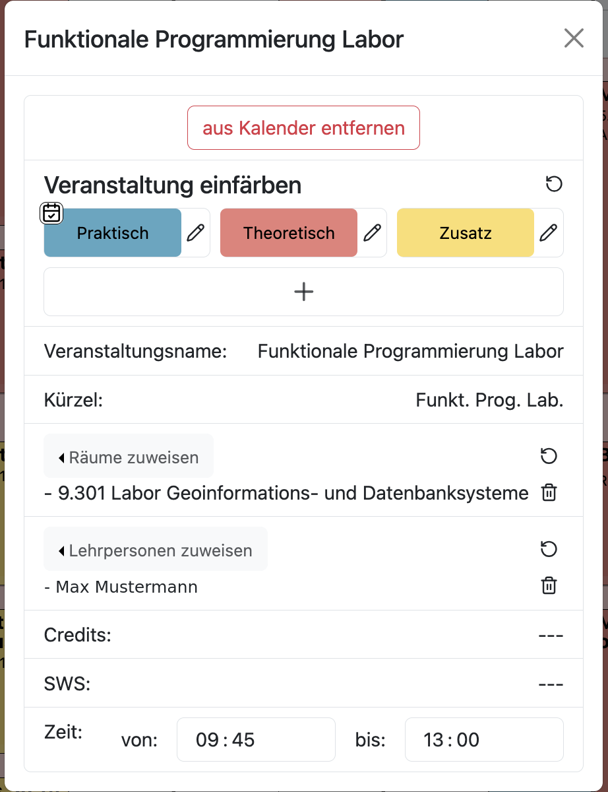

# Detailansicht

Ein Klick auf eine bereits geplante Veranstaltung im Stundenplan öffnet deren Detailansicht. In dieser können Räume und Lehrpersonen zugewiesen, der Zeitraum korrigiert und die Veranstaltung eingefärbt werden. Auch das Entfernen der Veranstaltung aus dem Kalender erfolgt in der Anischt.

Dabei ist zu beachten, dass sich nicht alle Änderungen nur auf den angeklickten Eintrag auswirken. Ein zugewiesener Raum gilt ausschließlich für den angeklickten Zeitraum, während Lehrpersonen und Farbe der Veranstaltung als Ganzes zugeordnet sind und damit für alle geplanten Zeiträume dieser Veranstaltung gelten.

## Nicht bearbeitbare Informationen

Folgende Daten der Veranstaltung werden in der Detailansicht lediglich angezeigt:

- Veranstaltungsname
- Kürzel
- Credits
- SWS

Eine Änderung dieser Daten ist nur über die Verwaltung der Veranstaltung in der Sidebar möglich.

## Räume zuweisen

Über die Auswahl **Räume zuweisen** wird dem angeklickten Zeitraum ein oder mehrere Räume zugeordnet. Die Auswahl enthält eine Suchleiste, sodass sich auch bei vielen hinterlegten Räumen der gewünschte Raum schnell finden lässt. Bereits zugewiesene Räume werden darunter mit Raumnummer und Bezeichnung aufgelistet und können dort einzeln wieder entfernt werden. Über den Zurücksetzen-Button rechts neben der Auswahl werden alle zugewiesenen Räume auf einmal entfernt.

Die Raumzuweisung gilt ausschließlich für den angeklickten Zeitraum. Wird dieselbe Veranstaltung mehrfach in der Woche geplant, kann jeder dieser Zeiträume ein eigener Raum zugeordnet werden.

## Lehrpersonen zuweisen

Die Auswahl **Lehrpersonen zuweisen** funktioniert nach demselben Prinzip. Über eine durchsuchbare Liste werden Lehrpersonen zugeordnet, bereits zugewiesene Lehrpersonen erscheinen darunter und lassen sich einzeln oder über den Zurücksetzen-Button vollständig entfernen.

Im Gegensatz zur Raumzuweisung ist die Lehrperson jedoch der Veranstaltung selbst zugeordnet. Eine hier vorgenommene Änderung wirkt sich deshalb auf alle geplanten Zeiträume dieser Veranstaltung aus und ist anschließend auch im individuellen Stundenplan der Lehrperson sichtbar.

## Zeitraum anpassen

Am Ende der Detailansicht lässt sich über die beiden Felder **von** und **bis** die Uhrzeit des Zeitraums exakt festlegen.

Die geänderten Zeiten werden beim Schließen der Detailansicht übernommen. Dabei greifen zwei Korrekturen:

- Liegt die Endzeit vor der Startzeit, werden beide Zeiten automatisch getauscht. Ausgenommen ist die Endzeit `00:00`, die als Ende des Tages interpretiert wird.
- Liegt die Startzeit vor dem frühesten im Stundenplan dargestellten Zeitpunkt, wird die Änderung verworfen und der bisherige Zeitraum beibehalten.

## Veranstaltung einfärben

Der Bereich **Veranstaltung einfärben** erlaubt es, der Veranstaltung eine Farbe mit frei definierter Bedeutung zuzuweisen und die verfügbaren Farben direkt hier zu verwalten. Eine ausführliche Beschreibung findet sich unter [Farbsystem](Farbsystem.md).

## Veranstaltung aus dem Kalender entfernen

Über den Button **aus Kalender entfernen** wird der angeklickte Zeitraum aus dem Stundenplan gelöscht. Entfernt wird dabei ausschließlich die zeitliche Einplanung – die Veranstaltung selbst bleibt erhalten und kann jederzeit erneut eingeplant werden.

> **Hinweis:**  
> Wird eine Veranstaltung von mehreren Semestergruppen besucht, entfällt der Zeitraum für alle beteiligten Semestergruppen.
