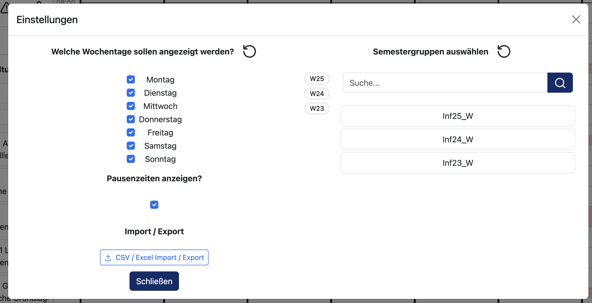

# Einstellungen

Über den **Einstellungs-Button** oben in der Sidebar öffnet sich ein Pop-up, in dem sich die Anzeige des Stundenplans anpassen sowie Daten importieren und exportieren lassen.

## Wochentage

Im Pop-up lassen sich einzelne Wochentage deselektieren. So können ungenutzte Tage, wie beispielsweise der Sonntag, ausgeblendet werden, um mehr Platz für die Planung zusätzlicher Semestergruppen zu schaffen.

## Pausenzeiten

Über eine Checkbox lassen sich Pausenzeiten ein- bzw. ausblenden. Diese haben, abgesehen von der visuellen Hilfestellung beim Planen, keinen weiteren Einfluss auf die Funktionsweise der Software.

## Semestergruppenauswahl

Die Semestergruppenauswahl ist die wichtigste aller Einstellungen. Hierbei handelt es sich um eine Liste aller Semestergruppen, aus denen eine beliebige Anzahl ausgewählt werden kann. Nur für ausgewählte Semestergruppen kann in der Veranstaltungsansicht geplant werden. In der Sidebar werden ebenfalls nur Veranstaltungen angezeigt, an denen mindestens eine der gewählten Semestergruppen teilnimmt.

Die Auswahl besteht aus drei Teilen:

### Suchleiste

Über die Suchleiste lässt sich die Liste der Semestergruppen durchsuchen, um schnell eine bestimmte Gruppe zu finden.

### Studiengruppen

Darunter werden die Semestergruppen als anklickbare Liste angezeigt. Ein Klick auf eine Gruppe wählt diese aus bzw. hebt eine bestehende Auswahl wieder auf.

### Semesterfilter

Zusätzlich lässt sich die Liste nach Semestern (z. B. W25) filtern. Es werden dann nur die Semestergruppen angezeigt, die zu den ausgewählten Semestern gehören. Werden mehrere Semester ausgewählt, werden entsprechend auch die Semestergruppen aller gewählten Semester angezeigt.

Die verfügbaren Semesterfilter sind dynamisch: Ein Semester (z. B. W25) taucht nur dann als Filteroption auf, wenn tatsächlich mindestens eine Semestergruppe existiert, die in diesem Semester begonnen hat.

> **Hinweis:**  
> Der Semesterfilter wirkt sich nur auf die angezeigte Liste aus. Bereits ausgewählte Semestergruppen bleiben unabhängig vom Filter ausgewählt.

## Import/Export

Über einen weiteren Menüpunkt im Einstellungs-Pop-up lassen sich Daten als CSV-Datei importieren und exportieren.
