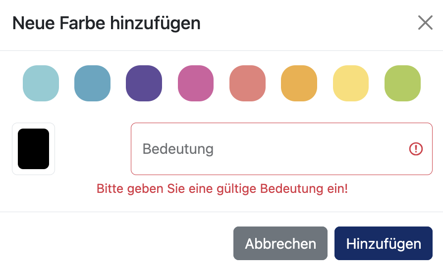
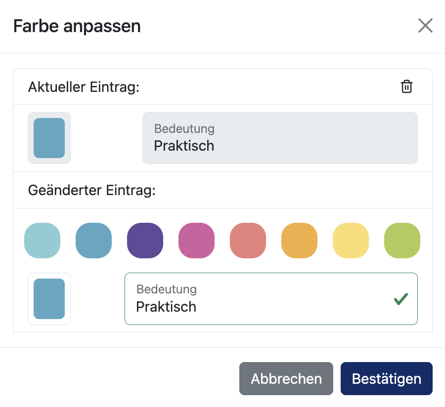

# Farbsystem

Über Farben lassen sich Veranstaltungen im Stundenplan nach frei wählbaren Eigenschaften unterscheiden, beispielsweise nach dem Stand der Planung. Zu jeder Farbe wird eine Bedeutung hinterlegt, sodass die Einfärbung im Stundenplan nachvollziehbar bleibt.

Verwaltet und vergeben werden die Farben im Bereich **Veranstaltung einfärben** der [Detailansicht](Detailansicht.md) einer Veranstaltung.

Die angelegten Farben bilden eine gemeinsame Liste, die für die gesamte Planung gilt. Eine einmal angelegte Farbe steht deshalb bei jeder Veranstaltung zur Auswahl.

## Veranstaltung einfärben

Der Bereich **Veranstaltung einfärben** zeigt alle angelegten Farben jeweils mit ihrer hinterlegten Bedeutung an. Ein Klick auf eine dieser Farben weist sie der Veranstaltung zu. Die aktuell zugewiesene Farbe ist durch ein Symbol in der oberen Ecke des Eintrags gekennzeichnet.

Die Farbe wird der Veranstaltung als Ganzes zugeordnet. Alle geplanten Zeiträume dieser Veranstaltung werden dadurch einheitlich eingefärbt.

Über den Zurücksetzen-Button rechts neben der Überschrift wird die Zuweisung wieder aufgehoben und die Veranstaltung in ihrer ursprünglichen Farbe dargestellt.

## Neue Farbe anlegen

Ein Klick auf das Plus-Symbol unterhalb der Farbübersicht öffnet das Fenster zum erstellen einer Farbe. Die Farbe kann dort auf zwei Wegen bestimmt werden.

1. Auswahl einer der acht vorgegebenen Farben der Palette.
2. Bestimmung einer beliebigen eigenen Farbe über das Farbfeld darunter.

Im Feld **Bedeutung** wird anschließend festgelegt, wofür die Farbe steht. Diese Angabe ist verpflichtend, ohne sie lässt sich der Eintrag nicht anlegen. Ein Klick auf **Hinzufügen** übernimmt die neue Farbe in die Liste.

## Bestehende Farbe bearbeiten

Jeder Farbeintrag besitzt am rechten Rand ein Stift-Symbol, über das sich das Bearbeiten-Fenster öffnet. Dort werden der aktuelle und der geänderte Eintrag untereinander dargestellt, sodass die bisherige Farbe samt Bedeutung während der Bearbeitung sichtbar bleibt. Es können Farbe und Bedeutung angepasst werden.

Bereits eingefärbte Veranstaltungen werden nach dem Bestätigen automatisch in der neuen Farbe dargestellt.

## Farbe löschen

Das Löschen einer Farbe erfolgt ebenfalls über das Bearbeiten-Fenster. Ein Klick auf das Mülleimer-Symbol neben dem aktuellen Eintrag öffnet eine Sicherheitsabfrage, in der die betroffene Farbe zur Kontrolle noch einmal angezeigt wird.
