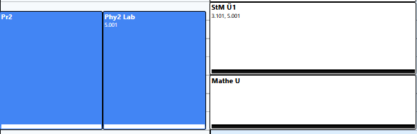
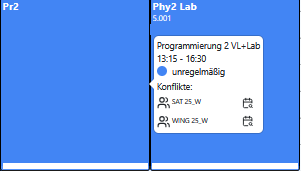
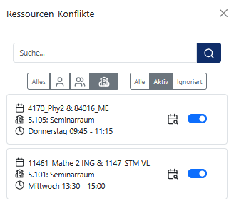

# Ressourcenkonflikte

Die Stundenplanung für viele Semestergruppem ist eine komplexe Aufgabe, bei der es schnell zur Entstehung von Ressourcenkonflikten kommt. Ein Ressourcenkonflikt liegt vor, wenn eine Ressource für denselben Zeitraum mehreren Veranstaltungen zugeordnet ist. 

Folgende Ressourcen können betroffen sein:

- Lehrpersonen
- Räume
- Semestergruppen

PlanLos erkennt Ressourcenkonflikte automatisch und zeigt diese unmittelbar an. Dadurch können Planungsfehler frühzeitig erkannt und behoben werden.

## Ressourcenkonflikte im Stundenplan

Konflikte werden direkt in den betroffenen Events durch einen schwarzen bzw. weißen Balken gekennzeichnet. Die Wahl der Farbe hat keine Bedeutung und ist nur von der Schriftfarbe abhängig, sodass der Balken immer gut sichtbar ist.

Um weitere Informationen zu einem Konflikt zu erhalten, gehe wie folgt vor:

1. Bewege den Mauszeiger über die betroffene Veranstaltung.

2. Es erscheint ein Tooltip mit Informationen zur Art des Konflikts sowie der konkret betroffenen Ressource.

    

## Konfliktübersicht

Alle Ressourcenkonflikte können zentral über die Konfliktübersicht eingesehen und bearbeitet werden.

1. Klicke auf das Warndreieck-Symbol in der oberen Sidebar. Sind aktive Ressourcenkonflikte vorhanden, wird deren Anzahl als Badge am Symbol angezeigt.

2. Es öffnet sich ein Popup mit der Liste aller bestehenden Ressourcenkonflikte.

Zu jedem Konflikt werden folgende Informationen angezeigt:

- Konfliktart
- betroffene Veranstaltungen
- betroffene Ressource
- betroffener Zeitraum
- Status des Konflikts (aktiv/ignoriert)

### Ressourcenkonflikte suchen und filtern

Zur besseren Übersicht stehen folgende Funktionen zur Verfügung:

- Suchen nach einer Ressource in der Suchleiste
- Filterung nach Konfliktart
- Filterung nach Konfliktstatus (aktiv/ignoriert)

## Ressourcenkonflikte ignorieren

Ein Ressourcenkonflikt kann als ignoriert markiert werden, wenn er bewusst in Kauf genommen werden soll.

1. Öffne die Konfliktübersicht.

2. Suche den gewünschten Konflikt.

3. Markiere den Konflikt als ignoriert, indem du den Slider-Button nach links verschiebst.

Ignorierte Konflikte werden anschließend nicht mehr als Konflikte in der Planung berücksichtigt. Sie können allerdings jederzeit wieder in der Konfliktübersicht aktiviert werden.

## Konfliktansicht

Sowohl im Tooltip einer Veranstaltung im Stundeplan als auch in der Konfliktübersicht steht ein Kalender-Button zur Verfügung. 

1. Klicke auf den Kalender-Button des entsprechenden Konflikts.

2. Es öffnet sich eine temporäre Ansicht mit dem individuellen Stundenplan der betroffenen Ressource.

3. Dort kann der Konflikt durch Anpassen oder Entfernen des beplanten Zeitraums behoben werden.

