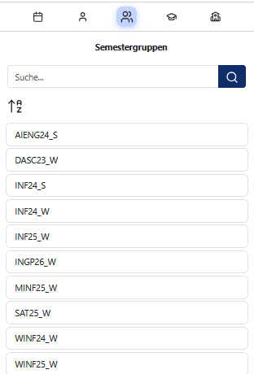
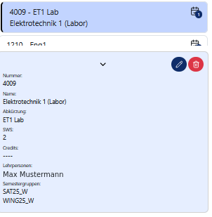
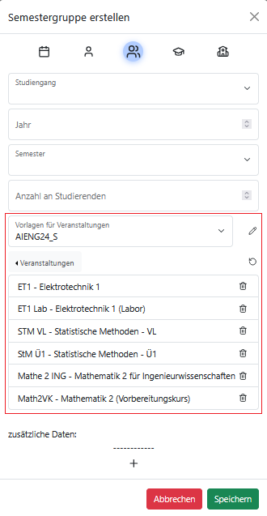
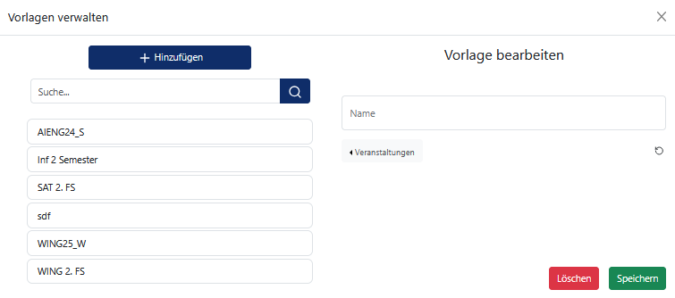

# Ressourcenverwaltung

Die Stundenplanung in PlanLos basiert auf verschiedenen Ressourcentypen. Bevor Veranstaltungen geplant werden können, müssen die Ressourcen angelegt und entsprechend ihrer Beziehungen untereinander verknüpft werden.

## Ressourcenübersicht

Es werden folgende Ressourcentypen verwaltet:

- Veranstaltungen
- Semestergruppen
- Lehrpersonen
- Räume
- Studiengänge

Alle diese Ressourcentypen besitzen einen eigenen Tab in der Sidebar. Dort werden alle vorhandenen Ressourcen des jeweils ausgewählten Typs in einer Liste angezeigt.

Für weitere Informationen lies die [Hinweise zur Sidebar](Sidebar.md).

Durch das Auswählen einer spezifischen Ressource wird deren Ansicht geöffnet. Bei Lehrpersonen, Räumen und Semestergruppen handelt es sich dabei um den individuellen Stundenplan. Für Studiengänge und Veranstaltungen gelten allerdings die folgenden Ausnahmen:

- **Studiengänge**: Studiengänge besitzen keinen eigenen Stundenplan und dienen ausschließlich der Verwaltung von Semestergruppen.

- **Veranstaltungen**: Statt eines individuellen Stundenplans für eine Veranstaltung wird in diesem Tab stets die Stundenplanungsansicht der ausgewählten Semestergruppen geöffnet. Veranstaltungen können hier von der Sidebar per Drag & Drop in den Kalender gezogen und eingeplant werden.

## Zusammenhang der Ressourcen

Die zentrale Ressource der Stundenplanung ist die **Veranstaltung**. Einer Veranstaltung können beliebig viele Semestergruppen sowie beliebig viele Lehrpersonen zugeordnet werden.

Jede Semestergruppe gehört genau einem Studiengang an und beschreibt einen konkreten Jahrgang eines Studiengangs. Dies wird über das Startjahr und -semester (Winter/Sommer) gekennzeichnet.

Die eigentliche Stundenplanung erfolgt auf Basis von Semestergruppen. Welche Semestergruppen aktuell geplant werden sollen, kann über das Einstellungsdialogfenster ausgewählt werden.

Veranstaltungen werden eingeplant, indem sie per Drag & Drop aus der Sidebar in den Kalender gezogen werden. Dabei wird farblich hervorgehoben, welche Semestergruppen an dieser Veranstaltung teilnehmen. Auch deaktivierte Semestergruppen werden beim Anlegen des Zeitslots berücksichtigt, sofern sie der Veranstaltung zugeordnet sind. Nach dem Einplanen können dem Zeitslot ein oder mehrere Räume zugeordnet werden. Dadurch ist es möglich, dass verschiedene Termine derselben Veranstaltung in unterschiedlichen Räumen stattfinden.

## Eigenschaften der Ressourcen

### Veranstaltung

Eine Veranstaltung besitzt folgende Eigenschaften:

- Veranstaltungsnummer
- Name
- Abkürzung
- Semesterwochenstunden (SWS)
- Credit Points (CP)
- zugeordnete Semestergruppen
- zugeordnete Lehrpersonen

### Semestergruppe

Eine Semestergruppe besitzt folgende Eigenschaften:

- Studiengang
- Jahrgang
- Startsemester (Sommer/Winter)
- Anzahl der Studierenden

### Lehrpersonen

Eine Lehrperson besitzt folgende Eigenschaften:

- Vorname
- Nachname
- Abkürzung
- Typ (Lehrperson, Laboringenieur, Lehrbeauftragter)
- Notizen

Lehrpersonen können außerdem für die Planung deaktiviert werden. Deaktivierte Lehrpersonen bleiben in den Stammdaten erhalten, können im Folgenden allerdings nicht mehr neu eingeplant werden.

### Räume

Ein Raum besitzt folgende Eigenschaften:

- Raumnummer
- Raumbezeichnung
- Anzahl der Sitzplätze

### Studiengang

Ein Studiengang besitzt folgende Eigenschaften:

- Name
- Abkürzung

### Zusätzliche Metadaten

Allen Ressourcentypen können beliebige zusätzliche Informationen in Form von Schlüssel-Wert-Paaren hinzugefügt werden. Diese eignen sich beispielsweise zum Speichern von organisationsspezifischen Metadaten.

## Ressourceninformationen anzeigen

Wird in der Sidebar eine Ressource ausgewählt, erscheint im unteren Bereich der Sidebar eine einklappbare Informationsansicht. Diese enthält alle Stammdaten der Ressource. Geplante Zeitslots werden in dieser Ansicht nicht angezeigt.

### Ressourcen bearbeiten

In der Informationsansicht können die Eigenschaften einer Ressource bearbeitet werden:

1. Wähle die Ressource in der Sidebar aus.

2. Öffne gegebenenfalls die Ressourcenansicht.

3. Klicke auf den Bearbeiten-Button.

4. Nimm die gewünschte Änderung vor.

5. Speichere die Änderung.

### Ressourcen löschen

Ressourcen können ebenfalls gelöscht werden:

1. Wähle die Ressource in der Sidebar aus.

2. Öffne gegebenenfalls die Ressourcenansicht.

3. Klicke auf den Löschen-Button.

4. Bestätige den Löschvorgang im erscheinenden Bestätigungsdialog.

Nach dem Bestätigen wird die Ressource dauerhaft aus dem System gelöscht.

## Ressourcen erstellen

Neue Ressourcen können jederzeit in der Sidebar angelegt werden:

1. Klicke auf den Plus-Button am oberen Rand der Sidebar.

2. Es öffnet sich ein Dialog zum Erstellen einer neuen Ressource.

3. Wähle den gewünschten Ressourcentyp aus. Standardmäßig ist der Reiter geöffnet, der dem aktuell in der Sidebar ausgewählten Ressourcentyp entspricht.

4. Fülle alle Pflichtfelder aus.

5. Klicke auf Speichern.

Sind nicht alle Pflichtfelder ausgefüllt, kann die Ressource nicht gespeichert werden. Fehlende Angaben werden entsprechend hervorgehoben.

## Zuweisung von Veranstaltungen zu Semestergruppen

Um die Verknüpfung von Ressourcen zu erleichtern, können einer Semestergruppe während ihrer Erstellung oder Bearbeitung die zugehörigen Veranstaltungen direkt zugewiesen werden. Somit ist es nicht mehr notwendig, jeder einzelnen Veranstaltung die jeweiligen Semestergruppen zuzuordnen, was den Verwaltungsaufwand senkt.

### Vorlagen

Darüber hinaus können Vorlagen für diese Zuweisung erstellt, bearbeitet und genutzt werden, um über Semester hinweg den Verwaltungsaufwand für Ressourcen zu minimieren.

Eine Vorlage besitzt einen Namen und enthält eine definierte Menge von Veranstaltungen. Du kannst sie beim Erstellen oder Bearbeiten einer Semestergruppe nutzen:

1. Du öffnest den Dialog zur Bearbeitung oder Erstellung einer Semestergruppe.

2. Gegebenenfalls füllst du fehlende Pflichtfelder aus.

3. Du wählst im Dropdown eine Vorlage aus.

4. Es werden die entsprechenden Veranstaltungen hinzugefügt.

5. Bei Bedarf entfernst du unnötige Veranstaltungen oder fügst weitere hinzu.

6. Du speicherst die neue bzw. überarbeitete Semestergruppe.

> **Hinweis:**  
> Falls du eine andere Vorlage auswählst, werden die zugewiesenen Veranstaltungen zurückgesetzt und nur die der Vorlage ausgewählt.

####  Veranstaltungskonfigurationen speichern

Nachdem einer Semestergruppe die gewünschten Veranstaltungen zugewiesen wurden, ist es möglich, diese Konfiguration unter dem Kürzel der Semestergruppe für folgende Semester direkt zu speichern. Dazu kann einfach auf den Button "Kurse speichern" geklickt werden.

#### Verwaltung der Vorlagen

Vorlagen sind kein eigener Ressourcentyp, weshalb sie in der Sidebar keinen eigenen Reiter besitzen. Stattdessen kann in den jeweiligen Tabs für Semestergruppen im Bearbeitungs- und Erstelldialog über das Bearbeiten-Symbol neben der Vorlagenauswahl ein eigenes Popup für die Verwaltung der Vorlagen geöffnet werden.

Das Erstellen einer Vorlage erfolgt auf der rechten Seite des Dialogs:

1. Gib im Textfeld einen Namen für die Vorlage an
2. Wähle im Dropdown "Veranstaltungen" alle gewünschten Kurse aus.
3. Klicke auf den Speichern-Button.

Um eine bestehende Vorlage zu bearbeiten:

1. Wähle auf der linken Seite die gewünschte Vorlage aus. Du kannst die Suchfunktion nutzen.
2. Auf der rechten Seite werden nun Name und Veranstaltungen der Vorlage bearbeitet werden.
3. Klicke auf den Speichern-Button.
