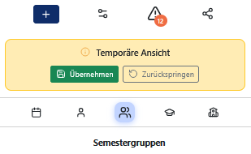

# Temporäre Ansicht

Temporäre Ansichten ermöglichen es, die aktuelle Planungsansicht vorübergehend zu ändern, ohne die eigenen Ansichtseinstellungen dauerhaft zu überschreiben. So können beispielsweise geteilte Ansichten anderer Nutzer oder Konfliktansichten geöffnet werden, ohne dass die eigenen Einstellungen verloren gehen. Nach Abschluss kann dann mit einem Klick die Arbeit an der eigenen Ansicht fortgeführt werden.

Während einer temporären Ansicht werden Änderungen an den Ansichtseinstellungen (z. B. ausgewählte Semestergruppen oder Wochentage) nicht dauerhaft gespeichert. Hingegen werden alle Änderungen an der Planung selbst, wie das Anlegen, Verschieben oder Löschen von Zeitslots sowie das Erstellen, Bearbeiten oder Löschen einer Ressource wie gewohnt übernommen und persistent gespeichert.

Temporäre Ansichten werden intern über einen Parameter in der URL gesteuert.

> **Hinweis:**  
> Temporäre Ansichten werden intern über einen Parameter in der URL gesteuert. Um eine Ansicht zu teilen, sollte daher nicht einfach die aktuelle URL kopiert werden. Verwende stattdessen die Funktion [Planungsansicht teilen](Teilen.md).

## Temporäre Ansichten erkennen

Eine temporäre Ansicht wird in der Regel nur auf einem der folgenden Wege geöffnet:

- Öffnen eines geteilten Links.

- Öffnen der Ansicht eines Ressourcenkonflikts.

Befindet man sich in einer temporären Ansicht, wird im oberen Bereich der Sidebar ein gelber Hinweis eingeblendet. Dieser zeigt an, dass sich die Anwendung momentan in einer temporären Ansicht befindet.

Folgende Optionen stehen zur Verfügung:

**Übernehmen**: Übernimmt die aktuellen Ansichtseinstellungen dauerhaft und verlässt die temporäre Ansicht. Anschließend werden wie gewohnt alle Änderungen für zukünftige Sitzungen gespeichert.

**Zurückspringen**: Schließt die temporäre Ansicht und stellt die zuvor verwendeten Ansichtseinstellungen wieder her.
