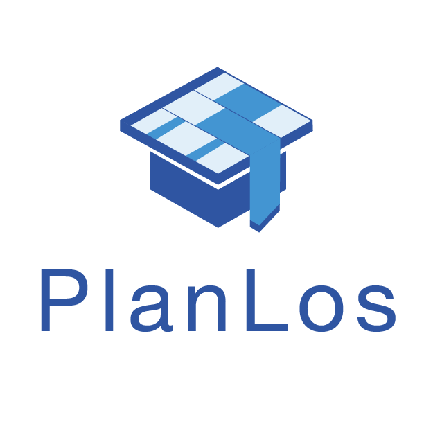

# Stundenplan Docs

{ width="300" }

Willkommen in der Dokumentation zu PlanLos, dem Stundenplan-Assistenzsystem.

- **[Benutzerhandbuch](benutzerhandbuch/index.md)**: Funktionen der Anwendung für Planende
- **[Entwicklung](entwicklung/LokalesSetup.md)**: Setup, Code Guide, API, Libraries und Tools für das Team
